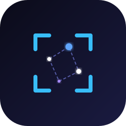
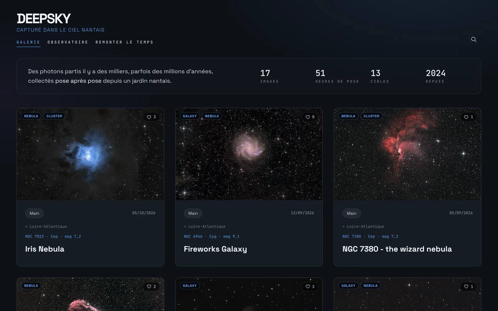
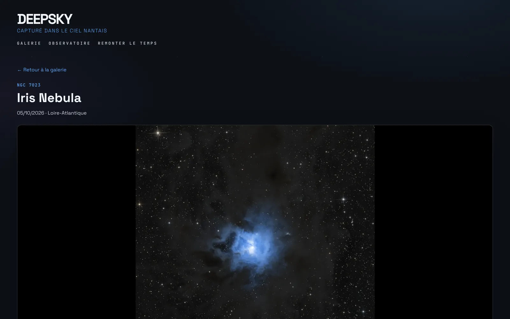
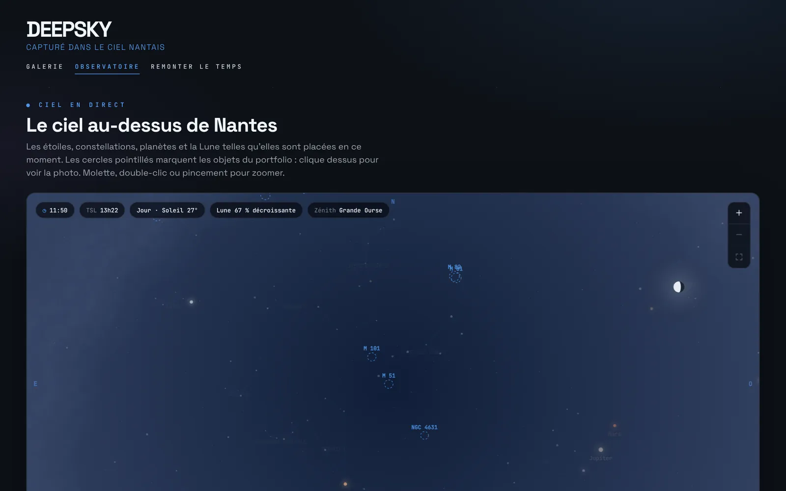
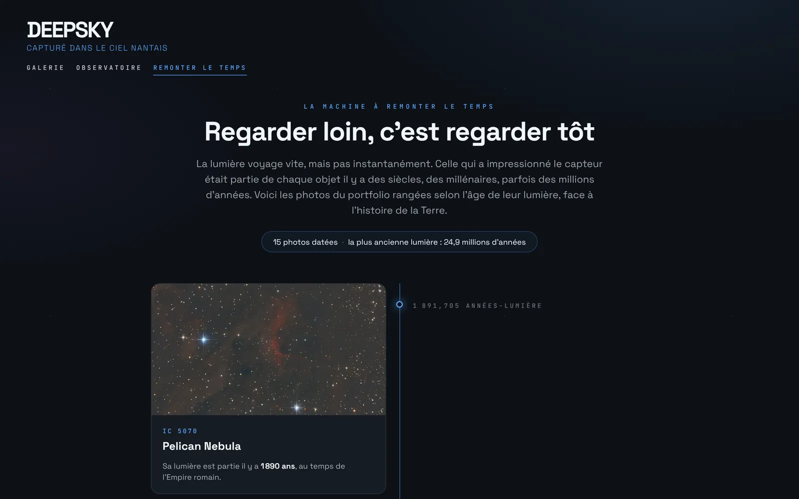
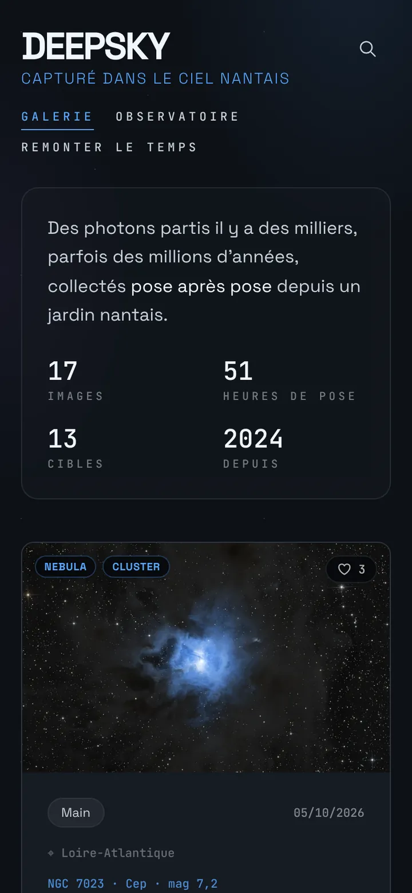
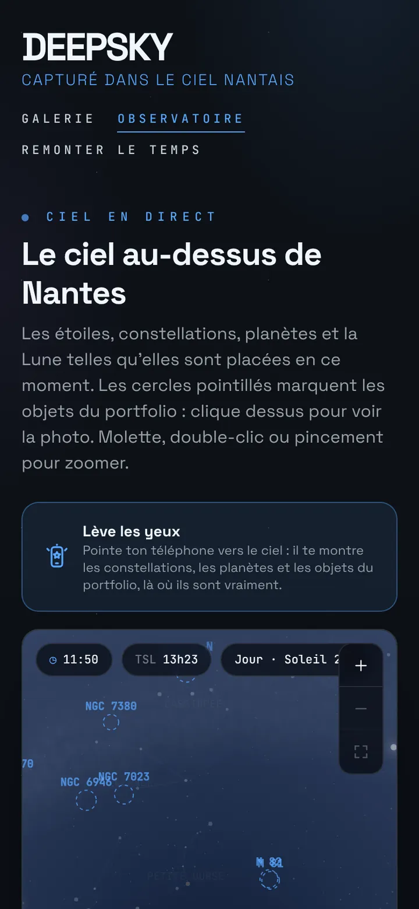
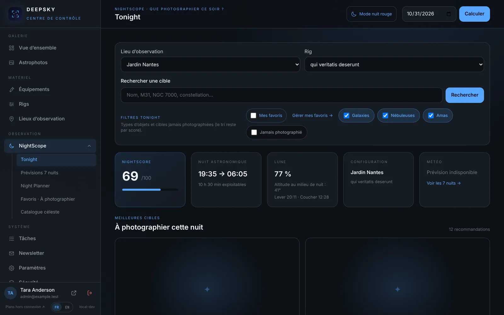
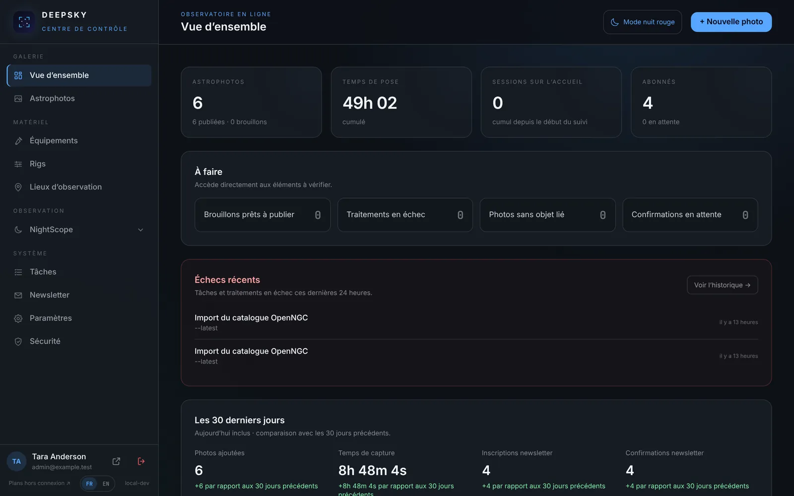
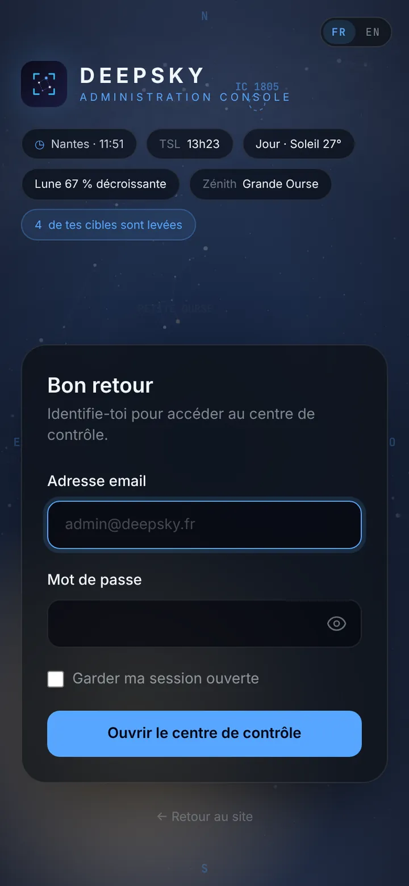

<div align="center">



# Deepsky

**A self-hosted astrophotography portfolio that thinks like an observatory.**

Every image is plate-solved, placed in the sky and dated by the age of its light.
Behind the scenes, **NightScope** plans your imaging nights.

[Live site](https://deepsky.nexus) · [Project page](https://pokertour.github.io/Deepsky/) · [Releases](https://github.com/pokertour/Deepsky/releases)




</div>

---

## Contents

- [Public site](#-public-site)
- [NightScope: the admin cockpit](#-nightscope-the-admin-cockpit)
- [Security](#-security)
- [Tech stack](#-tech-stack)
- [Deploy with Docker](#-deploy-with-docker)
- [Local development](#-local-development)
- [Configuration](#-configuration)
- [Releases and CI](#-releases-and-ci)

---

## 🌌 Public site

### Gallery and photo pages

Filter by object type, constellation, year and equipment. Each photo page details the acquisition sessions, filters, gear, starless version and **astrometric annotations**: objects in the field are identified automatically by [Astrometry.net](https://nova.astrometry.net), and their distances are fetched from [SIMBAD](https://simbad.cds.unistra.fr).



### Observatory: the live sky

A planetarium computed in the browser: stars, constellations, the Milky Way, planets and the Moon exactly where they are above your site right now. The objects you have photographed are circled, and one click opens the photo. Zoom, pan, and a slider to move forward through the night. The page also includes a logbook of acquisition nights and integration statistics.



### Back in time

All photos placed on a timeline by the **age of their light**, alongside the history of the Earth: from the Roman Empire to the age of the dinosaurs.



### And also

| | |
|---|---|
| **Look up** | Mobile augmented reality: point your phone at the sky and Deepsky draws the constellations, planets and portfolio objects where they really are, with an arrow guiding you to the chosen target. |
| **The Dive** | From a photo page, an animation starts from the whole sky and dives into the image's field. Each identified object tells how long its light has been travelling. |
| **Newsletter** | One email per publication, double opt-in, Cloudflare Turnstile or hCaptcha, one-click unsubscribe (RFC 8058), sent in the subscriber's language. |
| **Bilingual** | French and English, picked from the browser language or the FR / EN switch, with `hreflang` alternates and a bilingual sitemap. Photo texts can be translated with Gemini in one click. |
| **PWA** | Installable, with offline copies of night plans. |

<p align="center">
  
  
</p>

---

## 🔭 NightScope: the admin cockpit

The admin area is built for the field: usable on a phone, with a red night mode and plans available offline.



- **Tonight: what should I shoot?** Each target gets a score that combines altitude during astronomical night, the Moon, the weather, framing with your rig and how interesting the object is. Your garden's **horizon mask** (trees, roofs) is taken into account.
- **7-night astro forecast**: clouds, seeing, transparency, humidity and wind (Open-Meteo, 7Timer!).
- **Target detail**: altitude curve, framing preview with rotation and mosaic grid, filter advice based on the sky, the Moon and the Bortle class.
- **Night Planner**: proposals, saved plans, imaging sessions and favourites.
- **Observing locations**: interactive map, terrain elevation lookup, graphical horizon editor (draw over a photo or a 360° panorama).
- **FITS / XISF import**: drop your lights, flats and darks; the headers are read in the browser (nothing is uploaded) and fill in sessions, exposures, filters, gain and temperature.
- **Controlled publishing**: drafts, image conversion tracking, scheduled publication.
- **Gemini**: an accessible presentation of each object written from the catalogue, plus English translations of your texts.
- **Automated tasks**: processing history, one-click reruns, recovery of stuck conversions, purges, and alerts via Telegram, Gotify, ntfy or email.



---

## 🛡️ Security

- TOTP two-factor authentication with recovery codes
- Account lockout after 10 wrong passwords, per-IP rate limiting
- Sign-in log, with alerts on every sign-in or only from new devices
- Remote sign-out of other sessions
- Content Security Policy, HSTS, anti-clickjacking headers, trusted hosts and proxies
- Secrets encrypted in the database; the exact coordinates of observing locations are never published

<p align="center">
  
</p>

---

## 🧰 Tech stack

| Layer | Technology |
|---|---|
| Framework | Laravel 13, Octane (FrankenPHP) |
| Language | PHP 8.5 |
| Front end | Blade, Livewire 4, Alpine.js, Tailwind CSS 4, Vite |
| Database | MariaDB 11.4 in production, SQLite in development |
| Cache and queues | Redis |
| Images | Imagick (TIFF masters), spatie/laravel-medialibrary on S3-compatible storage (Cloudflare R2, MinIO…) |
| Astronomy services | Astrometry.net, SIMBAD, CDS hips2fits with a NASA SkyView fallback, OpenNGC, Open-Meteo, 7Timer! |
| Infrastructure | Docker, GitHub Actions, GitHub Container Registry |

---

## 🐳 Deploy with Docker

The image `ghcr.io/pokertour/deepsky-portfolio` is published for every release.

**Requirements:** Docker with Compose, an S3-compatible bucket for the images, and a domain name behind a reverse proxy (Nginx, Traefik, Caddy, Cloudflare Tunnel…).

```bash
git clone https://github.com/pokertour/Deepsky.git deepsky
cd deepsky
cp .env.example .env   # then fill in the values below
docker compose pull
docker compose up -d
docker exec -it deepsky-app php artisan user:set-password admin@example.com
```

The provided [`docker-compose.yml`](docker-compose.yml) runs:

- **app**: the application, exposed on port `8080`, with a built-in health check. On start-up it runs the migrations, warms the caches and starts the queue workers and the scheduler.
- **mariadb**: the database, only reachable from the host (`127.0.0.1:3308`).
- **mariadb-backup**: a daily compressed dump in `./backups`, kept for `BACKUP_RETENTION_DAYS` days (14 by default).
- **redis**: cache and queues.

Uploads of large masters (TIFF) are accepted up to **300 MB**; make sure your reverse proxy allows it (`client_max_body_size` on Nginx).

### Restore a backup

```bash
gunzip -c backups/deepsky-YYYYMMDD-HHMM.sql.gz | docker exec -i deepsky-mariadb mariadb -u deepsky -p deepsky
```

### Migrate from SQLite to MariaDB

Older installs based on SQLite can copy all their data to MariaDB, keeping the IDs:

```bash
docker exec -it deepsky-app php artisan app:migrate-to-mariadb
```

---

## 💻 Local development

```bash
git clone https://github.com/pokertour/Deepsky.git
cd Deepsky
composer run setup   # dependencies, .env, app key, migrations, assets
composer run dev     # server + queue + logs + Vite (use dev:win on Windows)
```

Development uses SQLite (`DB_CONNECTION=sqlite`).

Run the tests:

```bash
php artisan test
node --test tests/Browser/*.test.mjs
```

---

## ⚙️ Configuration

The main `.env` values:

| Variable | Purpose |
|---|---|
| `APP_URL` | Public address of the site |
| `APP_KEY` | Application key (`php artisan key:generate --show`) |
| `APP_LOCALE` | Default language: `fr` or `en` |
| `ADMIN_EMAILS` | Email address(es) of the admin account(s), comma-separated |
| `ADMIN_TIMEZONE` | Time zone used in the admin area (default `Europe/Paris`) |
| `DB_PASSWORD` | MariaDB password |
| `AWS_*` | S3-compatible bucket that stores the images |
| `TRUSTED_PROXIES` | Reverse proxy address, or `*` when the container is only reachable from a private network |
| `TRUSTED_HOSTS` | Allowed host names (for example `deepsky.example.com`) |
| `LIVE_SKY_*` | Place shown on the live sky (label, latitude, longitude, time zone) |
| `TURNSTILE_HOSTNAMES` | Host names accepted by the newsletter captcha check |

Everything else is set from the admin area under **Settings**: Astrometry.net and Gemini API keys, captcha provider (Cloudflare Turnstile or hCaptcha), SMTP server, and NightScope notification channels and language. Secrets are stored encrypted.

> After changing `.env` in production, rebuild the configuration cache: `docker exec deepsky-app php artisan config:cache`.

---

## 🚀 Releases and CI

- **Tests**: every push and pull request runs the PHPUnit suite, Pint, a dependency audit and the browser-side JavaScript tests.
- **Docker image**: pushing a `v*` tag, or running the **Docker build** workflow from the Actions tab with a version such as `v1.2.4`, builds the image, pushes it to GHCR and creates the GitHub release with generated notes.
- **Project page**: changes in `docs/` are published to GitHub Pages.

---

## 📄 License

Distributed under the MIT License. Made with patience under the skies of Nantes by [pokertour](https://github.com/pokertour).
